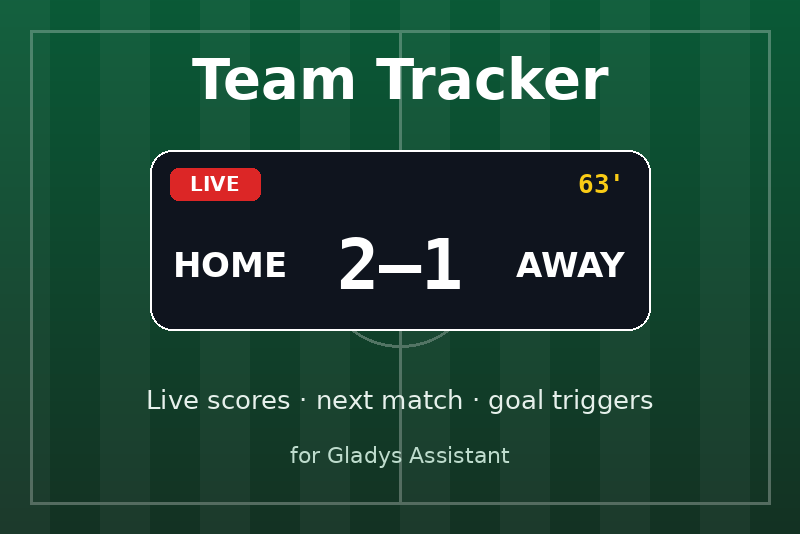

# Team Tracker for Gladys Assistant

External integration for [Gladys Assistant](https://gladysassistant.com) that follows
your sports teams: live scores, the next match, and scenes that run when your team
scores or wins. Soccer (Ligue 1, Premier League, Champions League…), rugby (Top 14, Six
Nations), NFL, NBA, NHL, MLB and more, from the public ESPN API — no account, no key.



Proposed on the Gladys forum among the
[Home Assistant integrations worth porting](https://community.gladysassistant.com/t/integrations-home-assistant-les-plus-populaires-candidates-pour-des-integrations-externes-gladys/10385/35):
a live-match widget and a "my team scored" trigger.

- **User documentation**: [English](docs/en.md) · [Français](docs/fr.md)
- **Requires** Gladys 5.1 or later.
- **Transport**: cloud (ESPN's internet API).

## What it does

| Surface               | What                                                                                             |
| --------------------- | ------------------------------------------------------------------------------------------------ |
| Devices               | One per team: team score, opponent score, "Match" status line (live clock, result, next kickoff) |
| Scene triggers        | `match_soon`, `match_started`, `team_scored`, `opponent_scored`, `match_ended`                   |
| Scene action          | `get_match`: state, scores, opponent, kickoff, result, summary of a team's match                 |
| Dashboard widgets     | `team_match` (one team, live tiles) and `my_teams` (every team, with logos and badges)           |
| Configuration buttons | `test_teams` (what is followed, and why not) and `find_team` (the exact `LEAGUE:TEAM` to paste)  |

Teams are written `LEAGUE:TEAM`, e.g. `LIG1:PSG, TOP14:RAC, NFL:KC`. The league codes
are listed in the [documentation](docs/en.md#leagues); any other ESPN team league works
with its `sport/league` path (`soccer/por.1:SLB`).

## How it works

```
                         ┌────────────── Gladys ──────────────┐
ESPN public API  ◄─────  │  Team Tracker container            │
 scoreboard / teams      │   tracker: read, compare, publish  │
                         │     ├─ devices + states            │
                         │     ├─ scene events (goal, end…)   │
                         │     └─ widgets, transport badge    │
                         └────────────────────────────────────┘
```

- **One request per league per reading**: the league scoreboard serves every followed
  team; a team not playing today gets its next match from its own page (cached).
- **The pace follows the matches**: every 30 s while a match is live, every 15 min
  otherwise, waking exactly for the kickoff reminder and the kickoff.
- **One scene event per transition**: a goal is the score going up between two
  readings. The last reading of each team is kept in `/data`, so a restart during a
  match neither replays nor misses a goal.
- **An ESPN outage keeps the last scores**, turns the device badge to "unreachable" and
  shows which teams are not followed in the Configuration screen.

## Project structure

```
.
├─ index.js                          # SDK wiring (handlers, connection lifecycle)
├─ src/
│  ├─ tracker.js                     # read ESPN, publish, fire events, pace the readings
│  ├─ events.js                      # two readings -> scene events (pure)
│  ├─ espn/client.js                 # ESPN endpoints + team logos
│  ├─ espn/parse.js                  # ESPN JSON -> a match seen from the team
│  ├─ devices/team.js                # the device of a followed team
│  ├─ leagues.js                     # league codes -> ESPN paths
│  ├─ config.js                      # defaults, normalization, LEAGUE:TEAM parsing
│  ├─ format.js                      # status lines and dates (en, fr)
│  ├─ store.js                       # last readings, in /data
│  ├─ actions.js                     # Configuration buttons
│  ├─ scenes.js                      # scene action get_match
│  └─ widgets.js                     # dashboard widgets + logos
├─ docs/en.md, docs/fr.md            # user documentation (re-hosted by Gladys)
├─ test/                             # node --test, ESPN fixtures, no network
├─ gladys-assistant-integration.json # manifest
├─ Dockerfile                        # Node 24 Alpine, read-only rootfs ready
├─ CHANGELOG.md · CLAUDE.md · SECURITY.md
└─ .github/                          # CI, release, build, GitHub releases, Dependabot
```

## Development

```bash
npm install
npm test               # unit tests (node --test), no network
npm run lint           # ESLint
npm run format:check   # Prettier, as the CI runs it
npx github:GladysAssistant/integration-store .   # store admission checks
```

Run it against a Gladys in developer mode:

```bash
GLADYS_HOST_API_URL="http://localhost:1443" \
GLADYS_INTEGRATION_TOKEN="<token>" \
GLADYS_INTEGRATION_SELECTOR="gladys-teamtracker" \
DATA_DIR=./data LOG_LEVEL=debug \
npm start
```

The CI (`.github/workflows/ci.yml`) runs Prettier, ESLint and the tests on Node 22 and
24; pull requests also get the store admission checks and a Docker build. The store
check needs the image named in the manifest to exist, so it stays red until the first
release is published.

## Release

1. Describe the changes under `## [Unreleased]` in [`CHANGELOG.md`](CHANGELOG.md).
2. **Actions → Release → Run workflow**, pick `patch`, `minor` or `major`.

The workflow bumps `package.json` and the manifest (`version`, `docker_image`), rolls the
changelog, tags `vX.Y.Z`, builds the `linux/amd64` + `linux/arm64` image to `ghcr.io`
and publishes the GitHub Release. The Gladys store indexer then offers the update.

Before the first release: add the GitHub topic `gladys-assistant-integration`, make the
`ghcr.io` package public after the first build, and turn on **Private vulnerability
reporting** (see [`SECURITY.md`](SECURITY.md)).

## Credits

- Built from the official
  [Gladys JavaScript integration template](https://github.com/GladysAssistant/integration-template-js).
- Idea and data source from the Home Assistant
  [Team Tracker](https://github.com/vasqued2/ha-teamtracker) integration by
  @vasqued2. No code was copied (it is GPL-3.0): this is a fresh implementation for
  Gladys.
- Scores and logos: ESPN's public API. This project is not affiliated with ESPN.

## License

Apache-2.0
